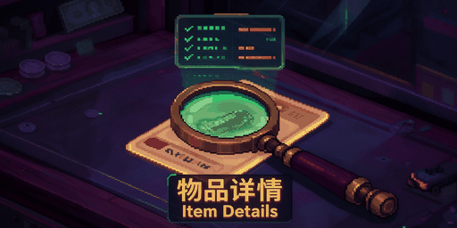

  

<h1 align="center">Item Details · 物品详情</h1>

  鼠标放上去，真伪、真实价值与隐藏信息就在提示框里。 
  不开新窗口，不改原版布局。

  <a href="https://steamcommunity.com/sharedfiles/filedetails/?id=3828868413">Steam 创意工坊</a>
  &nbsp;·&nbsp;
  <a href="#english">English</a>
  &nbsp;·&nbsp;
  <a href="CONTRIBUTING.md">参与翻译与开发</a>

 

## 鉴定

**真伪**
免疫宁注射器、海明威香烟、食品券，直接给出正品或赝品，并指出哪一项不合格。肋明治同样列出原因。

**真实价值**
仿生机械手、肋明治、等离子燃料匣，显示总价，并逐项拆开：

> 总价：275 ｜ 完美 261–288
> 来源：基础100+碳复合材料50+EMG+ 接口45+刀刃80

**鉴定服务标题**
面板标题附上标价与最优报价。

**荧光莓品质**
正常、较小、发霉、未熟、干枯，一眼可见。

## 物品与机器

**详细显示**
分类小标签、标签与瑕疵对价格的影响、每格价值、容器内容物、黑市溢价、电池天数、彩票结果、果酿分数。

**肉品来源**
来源物种与朊病毒标记。「未标记」不等于安全。

**机器内部**
滤芯耐久、水量、工具余量、完工天数、净水器今晚的净化量；熔炉预告下一块锭的档位。

**模组效果**
每项加成换算成实际影响，例如集水器 +136 毫升/天；自学习模组显示学习进度。

## 店内

**改造体与通缉犯**
顾客到店即提示，附举报奖励与真名；改造体另有击杀奖励与威胁值。

**对话回看**
鼠标停在顾客身上，重读这次接待的台词。不存档，换人即清空。

## 操作

**双击鉴定**
双击待鉴定物品直接打开鉴定面板，面板开着时双击另一件即可切换。

**右键扫描**
拥有对应设备时，液体、化学品、种子和上锁补给箱的右键菜单多出「扫描」。也可以改回旧版的双击扫描，两者能同时开启。

## 透视

这一组会明显降低难度，按喜好开启。

| 功能 | 效果 | 默认 |
|---|---|:---:|
| 真伪鉴定 | 正品／赝品与原因 | 开 |
| 估价计算 | 价值构成、完美报价区间、鉴定服务标题 | 开 |
| 顾客到店提示 | 改造体与通缉犯 | 开 |
| 揭示伪装与真实属性 | 被伪装的特性、真实耐久与纯度 | 开 |
| 植物分析 | 荧光莓品质、种子性状 | 有分析仪 |
| 液体组分分析 | 水质、杂质、药物与试剂成分 | 有扫描器 |
| 杂质按种类着色 | 杂质按种类各用一种颜色，关闭时统一白色 | 关 |
| 刮刮乐预知 | 刮开前知道奖金 | 关 |
| 带锁容器透视 | 不开锁也能看到内容物与估价 | 关 |
| 鉴定结果预填 | 预先勾好赝品问题、填好报价，不替你提交 | 关 |

## 设置

在游戏「模组」菜单里打开本模组设置，点「应用」生效。

设置分四组：信息补充、透视、排版、操作。勾选即使用本模组的改动，关闭即回到原版。

「物品信息补充」是信息补充组的总开关，关闭时本组的物品信息一并收起，已选的值保留；悬停顾客查看对话不受它控制。细项：每格价值、容器内容物、价格修正、黑市溢价、彩票、酿酒、肉类、机器、电池，默认全开，各自独立。

排版组只改原版内容的呈现方式，各项独立：提示框文字优化、公司名并入名称行、彩色进度条、液体容量用升显示、基因等级使用阿拉伯数字、物品分类标签、物品名称显示（图标底部常驻名称，可选容器和机器，或只显示改过名的物品）。

从属选项只在上级开启时出现。

「展开键」可选 Ctrl、Shift、Alt，用来展开作物成分表里折叠的成分；「物品详情美化」默认是 Shift。

## 原则

**只读** — 不改价格，不改顾客，不碰存档。

**无需权限** — 不联网，不启动进程，启用时不弹权限确认。

**算不准就不显示** — 价值拆解与游戏算出的数字完全一致才出现。

**第三方显式接入** — 其他模组自己登记价值构成与机器说明，不靠猜。

## 安装

订阅[创意工坊](https://steamcommunity.com/sharedfiles/filedetails/?id=3828868413)，或把发布包解压进游戏的 Mods 文件夹；在「模组」菜单启用后重启游戏。

需要正式版游戏（0.46D）。

## 语言

跟随游戏语言，支持游戏自带的全部 11 种。中英文以外是按原版用词校对过的机翻初稿，欢迎[指正](CONTRIBUTING.md)。

## 反馈

[Issues](https://github.com/Nwflower/item-details/issues)、创意工坊留言，或 QQ 群 **1132567943**。

游戏更新改了定价或界面后，相关信息可能暂时消失，等模组跟进即可。

## 许可

以 [GNU AGPL-3.0](LICENSE) 发布。游戏本体、Unity 与官方 SDK 不在授权范围内。

 

---

 

## English

Hover over an item and its tooltip shows authenticity, true value and hidden details.
No extra window, no change to the vanilla layout.

### Appraisal

**Authenticity** — Immunivax Injectors, Hemingway cigarettes and Food Stamps are marked genuine or counterfeit, with the failed check named. Ribwiches too.

**True value** — Cybernetic Hands, Ribwiches and Plasma Cartridges show the total, broken down line by line:

> Total: 275 | perfect 261-288
> From: Base 100+Carbon composite 50+EMG+ interface 45+Blade add-on 80

**Appraisal Service title** — list price and best offer.

**BloomBerry quality** — Normal, Small, Moldy, Underripe or Dried.

### Items and machines

**Rich details** — type badges, price impact of labels and defects, value per cell, container contents, black-market markups, battery days, lottery results, fruit wine scores.

**Meat origin** — species of origin and the prion tag. Unmarked does not mean safe.

**Inside machines** — filter durability, water level, tool uses, days to finish, tonight's purification; a furnace predicts the next ingot's tier.

**Module effects** — each bonus in real terms, such as +136 ml/day on a Moisture Farm; learning modules show their progress.

### In the shop

**Augmented and wanted alerts** — bounty and real name on arrival; augmented customers add kill reward and threat.

**Conversation recall** — hover over a customer to reread this visit's lines. Nothing is saved.

### Controls

**Double-click to inspect** — open the inspection panel without the Magnifying Glass.

**Scan from the context menu** — with the matching scanner, liquids, chemicals, seeds and locked crates gain a Scan entry. The old double-click scan is still available.

### Reveal

These make the game noticeably easier. Authenticity Check, Plant Analysis, Appraisal Calculator, Customer Arrival Alert, Reveal Disguises & True Stats and Liquid Composition Analysis are on by default; Scratcher Preview, Locked Container X-Ray and Prefill Inspection Result are off.

### Settings

Open the mod's settings from the Mods menu and click Apply. Settings come in four groups: Extra Info, Reveal, Layout and Controls; a ticked option uses the mod's change, unticked restores vanilla. Extra Item Info is the master switch of the Extra Info group; off, its item info options fold away and keep their values. Customer dialogue on hover is not under it. Layout options only change how vanilla text is presented and are each independent. Sub-options appear only while their parent is on. Expand Key (Ctrl, Shift or Alt) unfolds crop composition tables; Better Item Tooltips uses Shift by default.

### Principles

Read-only: no price, customer or save changes. No permissions, network or processes. A breakdown appears only when it matches the game's own value. Other mods register their own data instead of being guessed at.

### Install

Subscribe on the [Steam Workshop](https://steamcommunity.com/sharedfiles/filedetails/?id=3828868413), or extract the release package into the game's Mods folder. Enable it in the Mods menu and restart. Requires the full release (0.46D).

### Languages

Follows the game language; all 11 bundled languages are supported. Languages other than Chinese and English are reviewed machine translations — [improvements welcome](CONTRIBUTING.md).

Licensed under [GNU AGPL-3.0](LICENSE).
